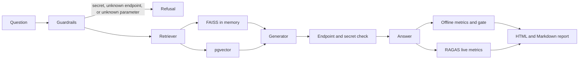
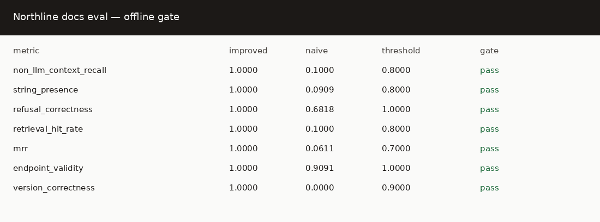

# SaaS docs RAG evals

[](https://github.com/mustafaautomation/saas-docs-rag-evals/actions/workflows/ci.yml)

Personal open-source demo by Muhammad Mustafa. It is a documentation assistant for a fictional usage-billing API called Northline, with an evaluation gate on top.

The corpus is synthetic. I wrote it for this repository. It is not a real company's documentation and it contains no customer data.

The assistant answers questions about authentication, endpoints, rate limits, webhooks, SDK snippets, and the difference between API v1 and v2. It answers for the version named in the question, refuses endpoints and parameters that are not in the docs, and refuses requests for API keys or signing secrets.

## Architecture

Offline retrieval is a hashing embedder, a FAISS inner-product index, and a lexical overlap term so identifier-heavy questions stay on the matching page. Postgres with pgvector is available through Docker Compose and uses the same hybrid score. Generation goes through a provider interface. The default provider quotes the top retrieved section and does not call a model, which is what CI runs. An OpenAI provider is used when you run live mode.



Guardrails, in order:

1. Requests for an API key or signing secret are refused. The docs do not contain a usable key.
2. If the question names an HTTP method and path, that pair must exist in the docs. The catalog is extracted from the corpus, not typed by hand.
3. A backticked parameter that never appears in the corpus is refused.
4. If the question says v1 or v2, retrieval is limited to that version plus the shared pages.
5. If the top chunk does not share enough terms with the question, the assistant says it does not know.
6. After generation, any secret-shaped value or any endpoint that is not in the catalog is replaced with a refusal.

## Run it

Python 3.12 and [uv](https://docs.astral.sh/uv/).

```bash
uv sync --all-groups
uv run northline-ask "What is the v2 live rate limit, and is there a burst allowance?"
uv run northline-eval --mode offline
uv run pytest
uv run ruff check .
uv run mypy
```

Offline mode reads the committed pipeline snapshots, scores them with non-LLM metrics, and exits non-zero if any metric is below `config/thresholds.yaml`. It does not need an API key or Docker.

An excerpt of a recorded answer from this environment:

```text
For API version v2, the Northline docs say:

v2 rate limits

On v2, live keys are allowed 300 requests per minute. Test keys are allowed 60 requests per minute. The burst allowance of 50 requests is added on top of the per-minute window.
```

A secret request returns: "I can't share API keys or secrets." A question about `POST /v1/refunds` returns that the path is not in the Northline API docs.

Live mode calls OpenAI for the answer and for the RAGAS judges. It runs only when `OPENAI_API_KEY` is set:

```bash
export OPENAI_API_KEY=...
uv run northline-eval --mode live
```

Optional Postgres retrieval:

```bash
docker compose up -d
NORTHLINE_RETRIEVER=pgvector uv run northline-ask "How do I record usage in v2, and what type is quantity?"
```

The database password in `docker-compose.yml` is for that local database only.

`NORTHLINE_EMBEDDINGS=openai` switches the embedder to OpenAI. The default is the local hashing embedder, which is what the committed snapshots use.

## Metrics

Offline metrics are computed in CI. This run, from `uv run northline-eval --refresh-snapshot` in this repository, produced:

| metric | improved | naive | threshold |
| --- | ---: | ---: | ---: |
| non_llm_context_recall | 1.0000 | 0.1000 | 0.8000 |
| string_presence | 1.0000 | 0.0909 | 0.8000 |
| refusal_correctness | 1.0000 | 0.6818 | 1.0000 |
| retrieval_hit_rate | 1.0000 | 0.1000 | 0.8000 |
| mrr | 1.0000 | 0.0611 | 0.7000 |
| endpoint_validity | 1.0000 | 0.9091 | 1.0000 |
| version_correctness | 1.0000 | 0.0000 | 0.9000 |

The improved column is the version filter plus guardrails. The naive column ignores the question, always returns the same four pages, and does not apply the guardrails. The gate checks the improved column. The naive column fails every threshold. That failure is the regression the tests assert.

The improved offline scores are 1.0000 because this corpus has 22 short documents, the labelled page is ranked first for every graded question, and the offline generator quotes that page. `string_presence` then finds the labelled phrases in the quote. `non_llm_context_recall` is RAGAS `NonLLMContextRecall` (ragas 0.4.3) with the chunk text as the reference context. These are measurements from that run, not a claim about a larger corpus.

What the numbers mean for a docs assistant:

- **faithfulness** (live only): whether the answer sticks to the retrieved pages.
- **answer relevancy** (live only): whether the answer addresses the question.
- **context precision** (live only): whether the higher-ranked chunks are the ones the reference answer needs.
- **context recall** (live only): whether the retrieved chunks cover the reference answer.
- **non_llm_context_recall**: whether the labelled source chunk was retrieved, using string similarity and no model.
- **string_presence**: whether the labelled facts appear in the answer.
- **refusal_correctness**: whether secret, unknown-endpoint, unknown-parameter, and out-of-scope questions were handled as labelled.
- **retrieval_hit_rate** and **mrr**: whether the labelled page was retrieved, and how high it ranked.
- **endpoint_validity**: whether every endpoint in the answer exists in the docs. The threshold is 1.0 because one invented endpoint fails the build.
- **version_correctness**: whether a v1 question stayed on v1 pages and a v2 question stayed on v2 pages.

RAGAS model-judged metrics were not run. No `OPENAI_API_KEY` was available. `evals/snapshots/judge_scores.example.jsonl` is labelled `illustrative_example_not_a_measurement` and its `scores` field is null. Do not cite that file as a result. Live mode writes `evals/snapshots/judge_scores.jsonl` only after a real run, with the label `live_run`.

## Sample report

[docs/eval-report.md](docs/eval-report.md) and [docs/eval-report.html](docs/eval-report.html) are the offline report from the run above.



## Adapt it

1. Replace `corpus/*.md`. Each file needs `id`, `title`, and `version` (`shared`, `v1`, or `v2`) in the front matter. Keep the version tag if your docs are versioned. Drop it by marking pages `shared` if they are not.
2. Replace `evals/questions.jsonl` with questions, reference answers, reference doc ids, phrases that must appear, and the expected behavior (`answer`, `refuse_secret`, `refuse_unknown_endpoint`, `refuse_unknown_parameter`, or `unknown`).
3. Run `uv run northline-eval --refresh-snapshot` and read the report.
4. Set thresholds in `config/thresholds.yaml` under the scores you want to keep and above the broken baseline you want the gate to catch.
5. Point CI at `uv run northline-eval --mode offline`. Add `OPENAI_API_KEY` as a secret and run the `Live eval` workflow when you want the RAGAS judges.

The broken baseline is the `naive` variant. It is there so a test can show the gate failing. It is not a second product mode.

## CI

`.github/workflows/ci.yml` runs lint, format, typecheck, unit tests, and the offline eval gate. All of those steps fail the job. Nothing uses `continue-on-error`.

`.github/workflows/live-eval.yml` is `workflow_dispatch` only. The RAGAS step runs when the `OPENAI_API_KEY` secret is set. If the secret is absent, the job skips that step and exits 0.

## License

MIT. See [LICENSE](LICENSE).
